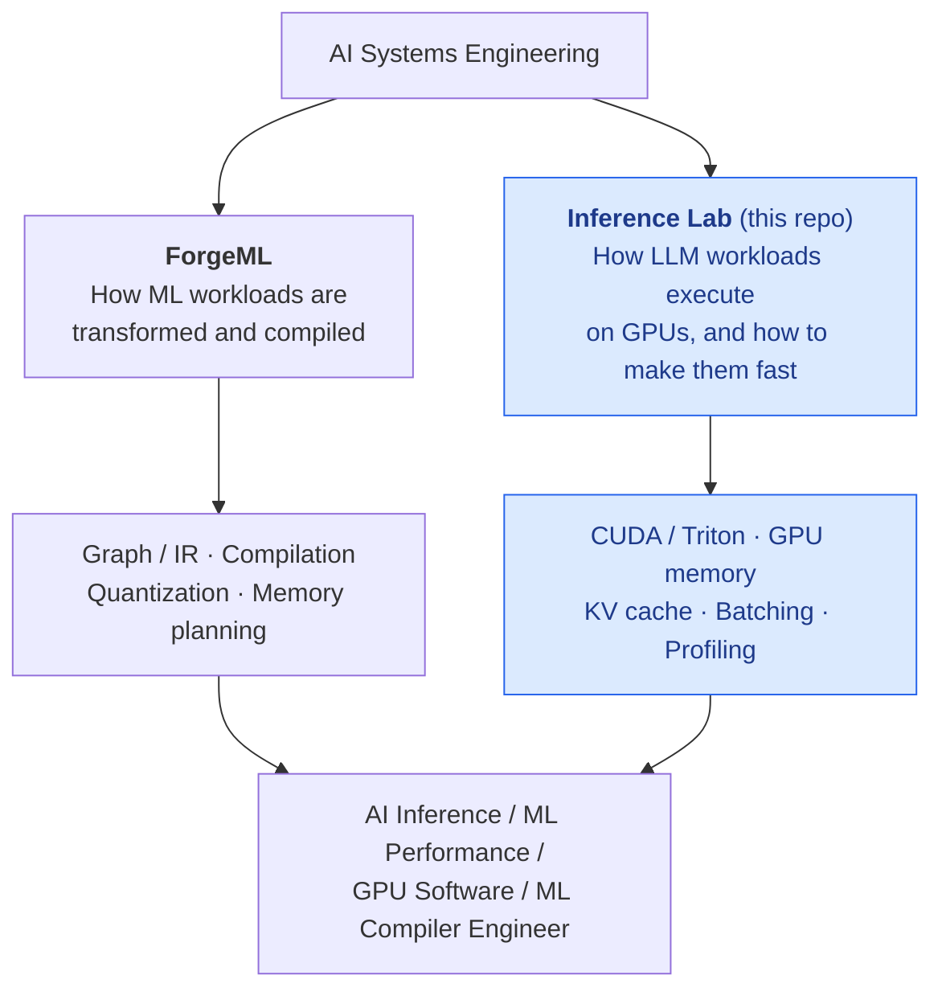
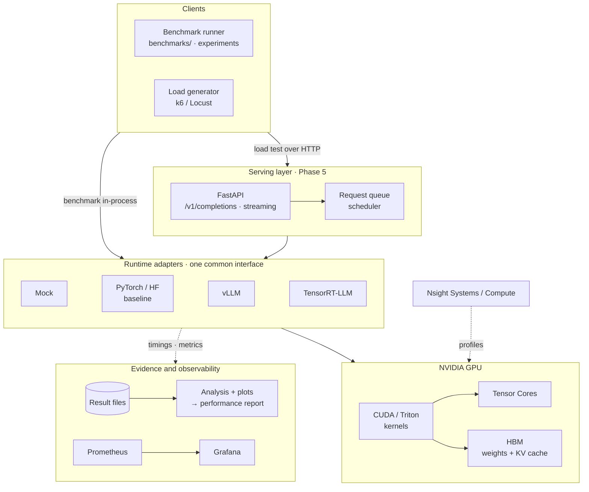
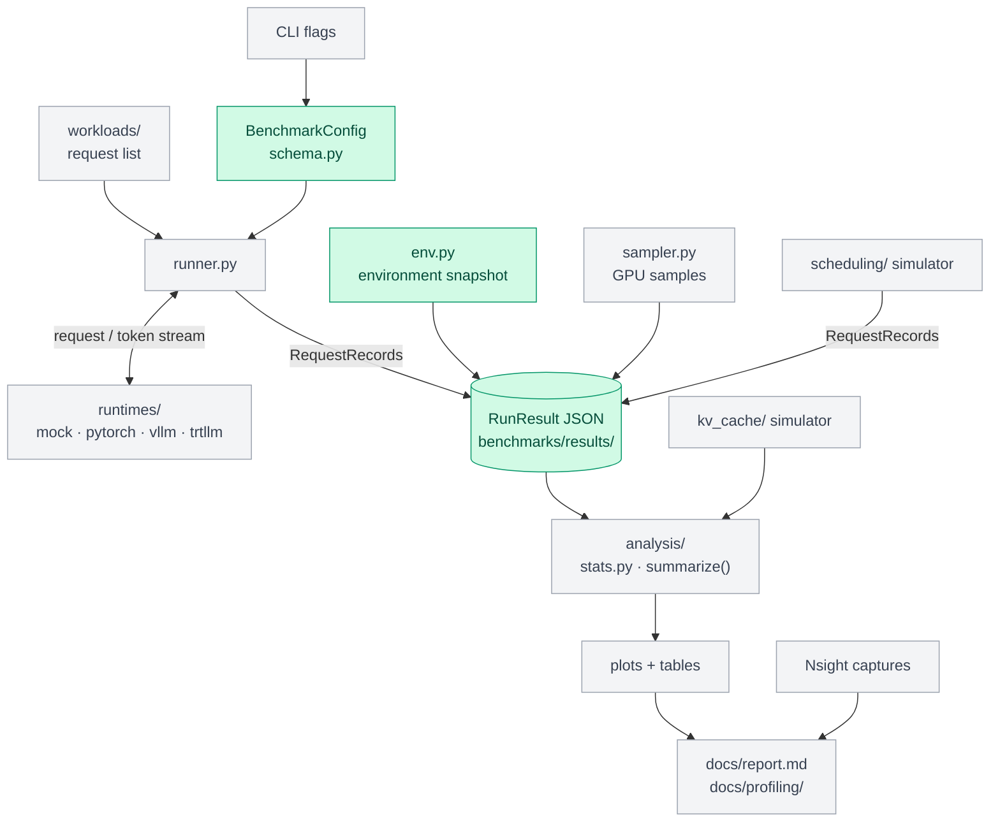
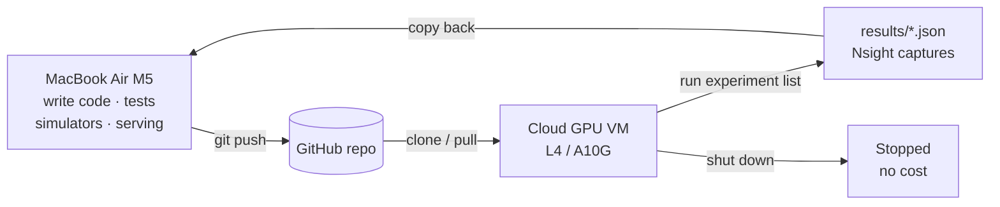
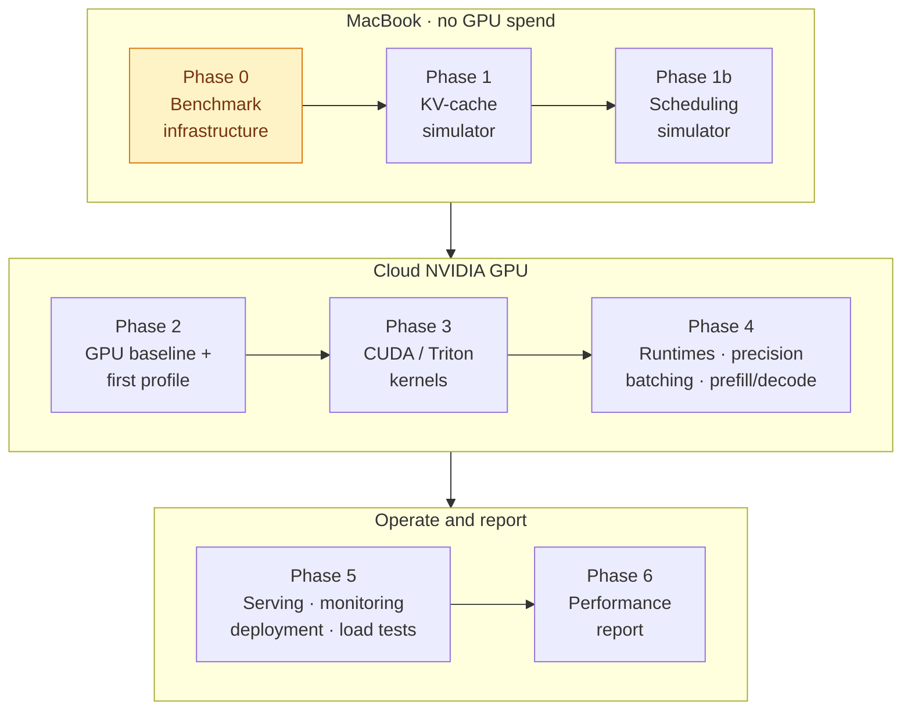
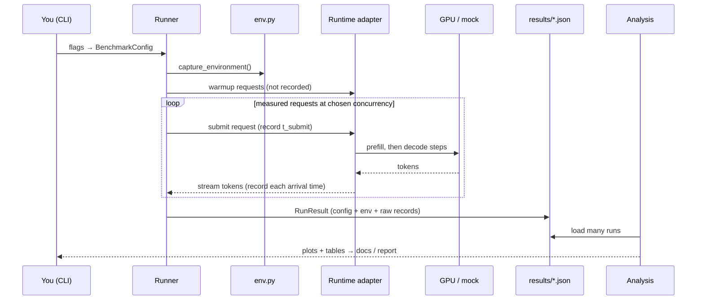
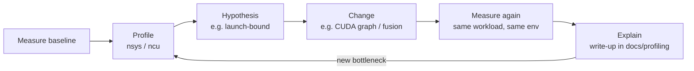
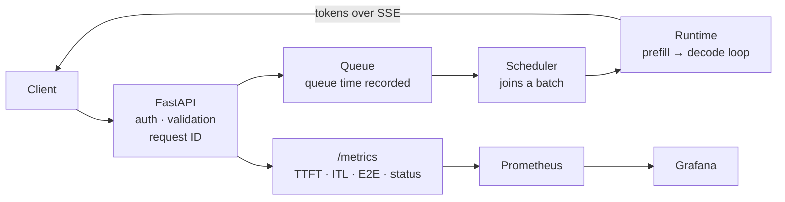

# LLM Inference Performance Lab: Project Guide

> **The living reference for this project.** It explains what we're building, why, how the pieces
> fit together, and what each module takes in and produces. Update it whenever a component,
> interface, decision or phase status changes (see [§13 Maintaining this guide](#13-maintaining-this-guide)).
>
> **Last updated:** 2026-10-11 · **Current phase:** 0, benchmark infrastructure · **Hard deadline:** Tue 22 Dec 2026

**Status legend:** ✅ done · 🚧 in progress · ⬜ planned · ❓ open decision

---

## Contents

1. [Goal](#1-goal)
2. [Positioning](#2-positioning)
3. [Architecture](#3-architecture)
4. [Hardware and environment strategy](#4-hardware-and-environment-strategy)
5. [Repository layout](#5-repository-layout)
6. [Phases](#6-phases)
7. [Components: inputs, outputs, examples](#7-components)
8. [End-to-end flows](#8-end-to-end-flows)
9. [Data contracts](#9-data-contracts)
10. [Experiment catalog](#10-experiment-catalog)
11. [Decision log](#11-decision-log)
12. [Changelog](#12-changelog)
13. [Maintaining this guide](#13-maintaining-this-guide)

---

## 1. Goal

**Central question:** How far can LLM inference performance on a GPU be pushed under explicit
latency, throughput and memory constraints, and can the bottleneck be explained at every layer?

**Method, applied to every optimization:**

```text
Measure → Profile → Hypothesize → Optimize → Measure again → Explain
```

**What success looks like:** being able to explain a complete inference workload, from the
transformer computation down to the GPU memory hierarchy and back up to production metrics, and to
answer "why is this slow?" with evidence.

**This is a performance engineering project.** It is not a chatbot, a RAG app, a Kubernetes
showcase or a cloud-architecture project. Serving and infrastructure exist only to show that the
optimized engine can be operated for real.

**Learning mode:** the owner writes the code. Claude acts as mentor and reviewer (see `CLAUDE.md`).

### The ten questions the final report must answer

| # | Question | Answered mainly by |
|---|---|---|
| Q1 | Where is inference spending its time? | Phases 2, 4: Nsight Systems, PyTorch profiler |
| Q2 | Is the workload compute-bound or memory-bound? | Phases 2, 3: roofline, Nsight Compute |
| Q3 | How does precision affect performance? | Phase 4: precision/quantization sweep |
| Q4 | How does batch size affect throughput and latency? | Phases 1b, 4: batching experiments |
| Q5 | What happens to KV-cache memory as concurrency increases? | Phases 1, 4: KV simulator + vLLM |
| Q6 | Why do vLLM and TensorRT-LLM outperform the baseline? | Phase 4: runtime comparison |
| Q7 | Where is GPU utilization being lost? | Phases 2–4: Nsight timelines |
| Q8 | Can a custom CUDA/Triton kernel improve the bottleneck? | Phase 3: kernels |
| Q9 | What throughput can be sustained before P99 latency becomes unacceptable? | Phases 4, 5: load tests, open-loop arrival |
| Q10 | What is the final improvement, and what caused it? | Final report |

---

## 2. Positioning



Where the owner's existing experience connects:

| Prior experience | Where it shows up here |
|---|---|
| Static memory planning, tensor reuse, address allocation | KV-cache simulator (contiguous vs paged allocation, fragmentation) |
| Operator fusion, tiling | Fused CUDA/Triton kernel, tiled GEMM |
| PTQ / QAT / partial quantization | Precision and quantization sweep (INT8/INT4 weight-only) |
| GEMM analysis | Tiled GEMM kernel, roofline analysis, prefill (GEMM) vs decode (GEMV) |

---

## 3. Architecture

### 3.1 Target system



There are two ways in:

- **Experiment path:** the benchmark runner calls runtimes directly (in-process) or through the API.
  This is where performance is measured and explained. It's most of the project.
- **Serving path:** clients go through FastAPI and the scheduler to a runtime. This shows the
  optimized engine can be operated with metrics, health checks and timeouts.

### 3.1b How the modules connect (data flow)

Green = built, grey = planned. Every producer of latency data writes the same `RequestRecord`
format, so one analysis pipeline handles real runtimes and simulators alike.



### 3.2 Layers and what each one tells us

| Layer | Question it answers | Tools |
|---|---|---|
| Transformer computation | Which FLOPs and bytes does each op need? | Arithmetic, roofline |
| Runtime | How are requests batched and how is the KV cache managed? | vLLM, TRT-LLM, simulators |
| Kernel | Is this kernel limited by compute, memory or latency? | Nsight Compute, CUDA, Triton |
| GPU timeline | Where is the GPU idle? Launch overhead? Syncs? | Nsight Systems, PyTorch profiler |
| Serving | Queueing, tail latency, saturation point | Load tests, Prometheus |

---

## 4. Hardware and environment strategy

| Machine | Used for | Not used for |
|---|---|---|
| **MacBook Air M5** (16 GB unified memory) | Harness, simulators, serving, monitoring, K8s manifests, writing kernels, testing bandwidth-bound predictions | Any number in the performance report |
| **Cloud NVIDIA GPU** (L4 or A10G, 24 GB, full VM) ❓ provider | Every report number: baselines, kernels, Nsight, vLLM, TRT-LLM, quantization | Development or debugging (that's paid time) |

**Rules:**
- Mac numbers only validate the harness. They never appear in the report.
- First GPU session: check that `ncu` (Nsight Compute) can read hardware counters before anything else.
- GPU sessions are scripted: provision → install → run the experiment list → copy results back → shut down.



**Toolchain:** Python 3.12, `uv` (dependencies pinned in `uv.lock`), pytest, ruff. The CUDA build of
torch is installed separately on the GPU machine to match its driver.

---

## 5. Repository layout

Planned modules are only created when there is real code for them.

```text
llm-inference-performance/
├── CLAUDE.md                     ✅ Context and mentor rules for Claude sessions
├── README.md                     ✅ Entry point
├── pyproject.toml, uv.lock       ✅ Pinned environment
├── docs/
│   ├── project-guide.md          ✅ This document
│   ├── benchmark-methodology.md  ✅ Metric definitions and measurement rules
│   ├── export/                   ✅ Builds the Word/PDF versions of this guide
│   ├── schedule.html             ✅ Day-by-day schedule tracker with live re-planning
│   ├── profiling/                ⬜ One write-up per Nsight investigation
│   └── report.md                 ⬜ Final performance report
├── benchmarks/
│   ├── env.py                    ✅ Environment snapshot
│   ├── stats.py                  ✅ Percentiles and distributions
│   ├── schema.py                 ✅ Config, per-request records, run results
│   ├── runtimes/                 ⬜ Runtime interface + adapters (mock, pytorch, vllm, trtllm)
│   ├── runner.py                 ⬜ Runs workloads against a runtime
│   ├── workloads/                ⬜ Prompt/output length definitions, arrival processes
│   ├── sampler.py                ⬜ GPU utilization and memory sampling
│   ├── analysis/                 ⬜ Load results → tables and plots
│   ├── results/                  ✅ Raw result JSON (committed)
│   └── plots/                    ⬜ Generated plots
├── kv_cache/                     ⬜ KV-cache allocation simulator
├── scheduling/                   ⬜ Batching/scheduling simulator
├── kernels/
│   ├── cuda/                     ⬜ vector add, reduction, tiled GEMM, fused kernel
│   └── triton/                   ⬜ Triton kernel(s)
├── serving/                      ⬜ FastAPI app and scheduler
├── deployment/                   ⬜ Docker, Kubernetes, GPU session scripts
├── monitoring/                   ⬜ Prometheus config, Grafana dashboards
├── tests/                        ✅ Unit tests
└── .github/workflows/            ⬜ CI: tests, lint, regression check
```

---

## 6. Phases

Each phase has a goal, deliverables and an exit criterion. A phase is done when its exit criterion
is met **and** this guide is updated.



| Phase | Where | Goal | Key deliverables | Exit criterion | Report Qs | Status |
|---|---|---|---|---|---|---|
| **0 Infrastructure** | Mac | A benchmark harness you trust | env capture, schema, stats, runtime interface, mock runtime, runner, CLI, plots | Mock runtime with known timings gives the expected TTFT/ITL within a justified tolerance | n/a | 🚧 |
| **1 KV-cache simulator** | Mac | Understand why paged KV caches exist | Contiguous vs paged allocator, fragmentation and max-concurrency analysis | Plots of utilization and max concurrency vs block size and sequence-length spread | Q5 | ⬜ |
| **1b Scheduling simulator** | Mac | Understand batching trade-offs before touching a GPU | No / static / continuous batching on top of the mock runtime | Latency vs throughput curves for each policy | Q4 | ⬜ |
| **2 GPU baseline** | GPU | A reliable PyTorch baseline on NVIDIA | Nsight check, HF baseline runtime adapter, GPU sampler, first Nsight Systems timeline | Reproducible baseline (repeat runs within a stated noise band) + first profiling write-up | Q1, Q2, Q7 | ⬜ |
| **3 Kernels** | GPU | Apply GPU optimization to real bottlenecks | 4 CUDA kernels + ≥1 Triton kernel, each with before/after profiles | Each kernel has a profile → hypothesis → change → measurement → explanation write-up | Q2, Q8 | ⬜ |
| **4 Runtimes and LLM optimizations** | GPU | Explain *why* optimized runtimes are faster | vLLM and TRT-LLM adapters, precision sweep, batching sweep, prefill vs decode, KV-cache comparison with Phase 1 | Runtime comparison with mechanisms backed by evidence | Q3–Q7, Q9 | ⬜ |
| **5 Serving and operations** | Mac → GPU | Operate the optimized engine for real | FastAPI, streaming, scheduler, metrics, Grafana, Docker, minimal K8s, load tests, CI regression | Saturation point found under open-loop load with a dashboard | Q9 | ⬜ |
| **6 Report** | — | Turn evidence into a strong engineering document | `docs/report.md` with methodology, results, analysis, limitations | All ten questions answered with measured evidence | Q10 | ⬜ |

**Effort split:** benchmarking 15% · CUDA/Triton 20% · profiling 20% · runtimes 15% ·
KV/batching 15% · serving 10% · docs 5%.

### Schedule and hard deadlines

Baseline plan: **328 hours** at 5 h/day, every day, starting Mon 12 Oct 2026, with a holiday from
20 to 25 Oct. It includes the roadmap reading for each phase (tasks marked "Roadmap reading") and
15 h of optional stretch experiments (prefix sharing, chunked prefill, prefix caching, speculative
decoding), which are the first things to cut if a phase slips. Each phase includes a buffer task.
Every task has a plain-words outcome. Day-by-day tracking, task check-off and live re-planning are in
[`docs/schedule.html`](schedule.html); open it in a browser.

| Phase | Hours | Starts | Hard deadline |
|---|---|---|---|
| 0 Infrastructure | 35.5 | Mon 12 Oct | Mon 19 Oct |
| 1 KV-cache simulator | 26.5 | Mon 19 Oct | Fri 30 Oct |
| 1b Scheduling simulator | 18 | Fri 30 Oct | Mon 2 Nov |
| 2 GPU baseline | 39 | Tue 3 Nov | Tue 10 Nov |
| 3 Kernels | 63 | Tue 10 Nov | Mon 23 Nov |
| 4 Runtimes and LLM optimizations | 79 | Mon 23 Nov | Wed 9 Dec |
| 5 Serving and operations | 44 | Wed 9 Dec | Thu 17 Dec |
| 6 Report | 23 | Fri 18 Dec | **Tue 22 Dec** |
| Project 2: distributed inference (separate, after the lab) | 89 | Tue 22 Dec | Sat 9 Jan 2027 |

Project 2 covers what this lab deliberately leaves out (tensor/pipeline parallelism, Ray/KubeRay,
a 70B model on 4 GPUs, a gateway with fallbacks, system-design practice). It is tracked in the same
file but does not count toward the lab's deadline, progress or required pace.

These deadlines are fixed. When work slips, the tracker re-plans the projected dates and shows the
pace needed to recover; the deadlines move only on a deliberate re-baseline (logged in §11).

---

## 7. Components

Each entry lists: **purpose · status · inputs → outputs · example · depends on**.

Examples marked *illustrative* show the **shape** of data only. They are not measurements.

### 7.1 Benchmark infrastructure (`benchmarks/`)

#### `env.py`: environment snapshot ✅

- **Purpose:** record everything about the machine and software that could affect a result, so any
  number can be traced back to where it came from.
- **Inputs:** none. It reads the system, installed packages, git, `nvidia-smi` and torch.
- **Outputs:** a JSON-serializable `dict` that is embedded in every result file.
- **Run it:** `uv run python -m benchmarks.env`
- **Example output** (actual snapshot from the M5, trimmed):

```json
{
  "python": "3.12.14",
  "cpu": {"machine": "arm64", "logical_cores": 10, "model": "Apple M5", "memory_bytes": 17179869184},
  "git": {"commit": null, "dirty": true},
  "packages": {"torch": null, "vllm": null, "...": "..."},
  "torch": null,
  "nvidia_smi": null,
  "env_vars": {"CUDA_LAUNCH_BLOCKING": null, "...": "..."}
}
```

- **Why the environment variables are captured:** for example, `CUDA_LAUNCH_BLOCKING=1` serializes
  every kernel launch and silently invalidates timing.

#### `stats.py`: latency distributions ✅

- **Purpose:** percentiles and summary statistics for latency samples.
- **Inputs:** a list of floats (latencies in ms).
- **Outputs:** `{n, mean, min, max, p50, p90, p95, p99}`.
- **Example:**

```python
distribution([1, 2, 3, 4])
# {"n": 4, "mean": 2.5, "min": 1, "max": 4, "p50": 2.5, "p90": 3.7, "p95": 3.85, "p99": 3.97}
```

- **Rule:** always report `n`. A P99 from fewer than ~100 samples is close to just the maximum.

#### `schema.py`: configs and results ✅

- **Purpose:** define what a benchmark run *is* and how it is stored. Metrics are derived from raw
  timestamps and never stored as typed-in numbers.
- **Types:**

| Type | Role |
|---|---|
| `BenchmarkConfig` | What was run: runtime, model, precision, quantization, batch size, concurrency, token lengths, request counts, seed, device |
| `RequestRecord` | One request: submit time + arrival time of each output token (ns) |
| `RunResult` | Config + environment + all `RequestRecord`s + wall time + device samples |
| `summarize()` | `RequestRecord`s → TTFT / ITL / TPOT / E2E distributions + throughput |

- **Example: from raw timestamps to metrics** (taken from the unit tests):

```text
Request submitted at t = 0 ms; tokens arrive at 100, 110, 130, 140 ms

TTFT = 100 ms                (first token − submit)
E2E  = 140 ms                (last token − submit)
ITL  = [10, 20, 10] ms       (gaps between tokens)
TPOT = (140 − 100) / 3 ≈ 13.3 ms   (mean decode time per token for this request)
```

- **Output file:** `benchmarks/results/<date>_<runtime>_<run_id>.json`. See [§9](#9-data-contracts).
- **Known review item:** open findings from Assignment 0 are tracked in [§11](#11-decision-log).

#### Runtime interface + adapters (`benchmarks/runtimes/`) ⬜ Assignment 1 ❓ design

- **Purpose:** one interface that the runner (and later the server) uses to talk to *any* engine:
  mock, PyTorch/HF, vLLM, TensorRT-LLM.
- **Requirements (the design is the owner's):**
  - Must be able to stream tokens, so that TTFT and ITL can be measured.
  - Must support running many requests at once (concurrency).
  - Must report failures per request without stopping the run.
  - Must fit both an in-process engine (HF `generate`, vLLM engine) and a remote HTTP server.
- **Inputs:** a request (prompt or prompt tokens, maximum output tokens, sampling settings).
- **Outputs:** a stream of tokens, with timing captured by the caller → `RequestRecord`.

#### Mock runtime ⬜ Assignment 1

- **Purpose:** a fake LLM with *known* timings, used to check the harness itself before any GPU is involved.
- **Inputs:** prefill time per prompt token, decode time per output token, optional slowdown under load.
- **Outputs:** a token stream with those timings.
- **Example:** with 50 ms prefill and 10 ms/token decode, a correct harness should measure
  TTFT ≈ 50 ms and ITL ≈ 10 ms. Any difference is overhead or error in the harness.

#### Runner + CLI ⬜ Assignment 1

- **Purpose:** run a workload against a runtime under a given concurrency and produce a `RunResult`.
- **Inputs:** `BenchmarkConfig` (from CLI flags), a runtime adapter, a workload.
- **Outputs:** a saved result JSON plus a short printed summary.
- **Example invocation** (target interface from the brief):

```bash
uv run python -m benchmarks.run \
    --runtime mock --precision fp16 --batch-size 8 \
    --input-tokens 1024 --output-tokens 256 --concurrency 16
```

- **Open decisions:** ❓ concurrency mechanism (threads / asyncio / processes) ·
  ❓ arrival process (closed loop / open loop) · ❓ warmup policy.

#### Workloads (`benchmarks/workloads/`) ⬜

- **Purpose:** define *what* traffic looks like, separately from *how* it is sent.
- **Inputs:** prompt-length and output-length distributions (fixed, uniform, or taken from a real
  dataset), number of requests, seed, arrival process.
- **Outputs:** a reproducible list of requests (same seed → same workload).
- **Example (illustrative):** `fixed-1024in-256out`, `chat-mix` (short prompts, varied outputs),
  `long-context` (long prompts, short outputs, which stresses prefill).

#### Device sampler (`benchmarks/sampler.py`) ⬜ Phase 2

- **Purpose:** record GPU state while a benchmark runs.
- **Inputs:** sampling interval, device index.
- **Outputs:** `device_samples`: a list of `{t_ns, gpu_util_pct, mem_used_bytes, power_w, sm_clock_mhz, ...}`.
- **Note:** "GPU utilization" from NVML means *a kernel was running*, not *the SMs were busy*.
  The difference is explained in the profiling write-ups.

#### Analysis and plots (`benchmarks/analysis/`) ⬜

- **Purpose:** turn result files into tables and plots with no manual copying.
- **Inputs:** a set of result JSON files (selected by filter, e.g. `runtime=vllm, precision=fp16`).
- **Outputs:** PNG/SVG plots in `benchmarks/plots/` and Markdown tables for the docs.
- **Example plots:** throughput vs P99 latency (one line per runtime); TTFT vs prompt length;
  ITL vs concurrency; KV-cache usage vs concurrency.

### 7.2 KV-cache simulator (`kv_cache/`) ⬜ Phase 1

- **Purpose:** show why paged/block KV allocation beats contiguous allocation. This builds directly
  on the owner's static memory-planning experience.
- **Inputs:**
  - Model shape: layers, KV heads, head dimension, bytes per element
  - Memory budget for the KV cache
  - Allocation policy: contiguous (reserve the maximum sequence length up front) vs paged (fixed-size blocks)
  - Block size (for paged)
  - A request trace: arrival time, prompt length, output length for each request
- **Outputs:** memory utilization over time, internal and external fragmentation, maximum number of
  concurrent requests, requests rejected or delayed.
- **Key relationship:**

```text
KV bytes per token = 2 (K and V) × layers × kv_heads × head_dim × bytes_per_element
```

*Illustrative arithmetic* for a hypothetical model (16 layers, 8 KV heads, head dim 64, FP16):
2 × 16 × 8 × 64 × 2 B = 32 KiB per token, so a 2,048-token sequence holds 64 MiB of KV cache.
- **Later:** compare the simulator's predictions with vLLM's actual behaviour in Phase 4.

### 7.3 Scheduling simulator (`scheduling/`) ⬜ Phase 1b

- **Purpose:** compare no batching, static batching and continuous batching on top of the mock runtime.
- **Inputs:** workload, batching policy, maximum batch size, a cost model for prefill and decode steps.
- **Outputs:** per-request records in the standard schema, so the same analysis code produces the plots.
- **Question:** how does batching move the latency/throughput trade-off, and what happens to ITL P99
  when prefills are mixed in with decode steps?

### 7.4 Inference backends ⬜ Phases 2 and 4

All backends sit behind the runtime interface, so they produce comparable result files.

| Backend | Purpose | Inspect / measure |
|---|---|---|
| PyTorch / HF | Baseline: plain eager inference | Kernel launches, idle GPU time, HF KV cache, prefill vs decode |
| vLLM | Paged KV cache + continuous batching | Block manager, scheduler, attention kernels, KV usage |
| TensorRT-LLM | Compiled engine, fused kernels, in-flight batching | Engine build options, kernel fusion, quantized kernels |

- **Model:** ❓ a 1–3B model for baselines and kernels, plus possibly a 7–8B model for memory-pressure experiments.
- **Precisions:** FP32 → FP16/BF16 → INT8 → INT4 (weight-only), plus FP8 if the GPU supports it.

### 7.5 Kernels (`kernels/`) ⬜ Phase 3

Each kernel follows: baseline → profile → hypothesis → optimization → profile → benchmark → explanation.

| Kernel | Teaches | Inputs → outputs | Key Nsight Compute metrics |
|---|---|---|---|
| Vector add | Memory access, coalescing | two vectors → sum | achieved DRAM bandwidth vs peak |
| Reduction | Shared memory, warp shuffles, syncs | vector → scalar | bandwidth, warp stall reasons |
| Tiled GEMM | Tiling, registers, arithmetic intensity | A (M×K), B (K×N) → C | FLOP/s vs peak, roofline position, occupancy |
| Fused inference kernel ❓ | Fusion in a real workload (e.g. RMSNorm, SiLU-mul, bias+activation) | layer activations → output | bytes moved vs unfused version |
| Triton kernel ❓ | Productivity vs control compared with CUDA | same as one of the above | latency, bandwidth, compared with PyTorch and CUDA |

**Output per kernel:** source, a correctness test against PyTorch, a benchmark result file and a
profiling write-up in `docs/profiling/`.

### 7.6 Profiling workflow ⬜ Phases 2–4

- **Nsight Systems** (timeline): CPU/GPU overlap, kernel launch gaps, syncs, memcpy, where the GPU is idle.
- **Nsight Compute** (per kernel): memory vs compute throughput, occupancy, registers, shared memory, stall reasons.
- **Output:** one write-up per investigation, in this format:

```text
Observed problem → Evidence (screenshot/metric) → Hypothesis → Change → Result (measured) → Conclusion
```

Profile files (`*.nsys-rep`, `*.ncu-rep`) are large and stay out of git. Write-ups link to them.

### 7.7 Serving (`serving/`) ⬜ Phase 5

- **Purpose:** expose the optimized engine for real use.
- **Endpoints:** `POST /v1/completions`, `POST /v1/chat/completions`, `GET /health` (liveness),
  `GET /ready` (model loaded), `GET /metrics` (Prometheus).
- **Example request/response** (illustrative, OpenAI-compatible shape):

```http
POST /v1/completions
{"model": "<model-id>", "prompt": "Explain paged attention", "max_tokens": 64, "stream": true}

→ text/event-stream
data: {"id": "req_…", "choices": [{"text": "Paged", "index": 0}]}
data: {"id": "req_…", "choices": [{"text": " attention", "index": 0}]}
data: [DONE]
```

- **Behaviour:** request IDs, timeouts, cancellation when the client disconnects, request-size
  limits, API key authentication, structured logs.

### 7.8 Monitoring (`monitoring/`) ⬜ Phase 5

- **Inputs:** `/metrics` from the server, GPU metrics (DCGM exporter or NVML).
- **Outputs:** a Grafana dashboard showing requests/s, P50/P95/P99 latency, TTFT, ITL, tokens/s, GPU
  utilization and memory, KV-cache utilization, queue time, error rate.

### 7.9 Deployment (`deployment/`) ⬜ Phase 5

- **Docker:** pinned, CUDA-compatible image with a health check.
- **Kubernetes:** minimal Deployment + Service with GPU resource requests, readiness and liveness
  probes, rolling update. Single-node k3s + NVIDIA GPU Operator on the cloud VM.
- **GPU session scripts:** provision → set up → run the experiment list → copy results back → shut down.

### 7.10 CI and regression checks (`.github/workflows/`) ⬜ Phase 5

- **On every push:** tests and lint (no GPU needed).
- **Regression check:** the mock-runtime benchmark checks that the harness itself hasn't drifted.
  GPU regression checks run on demand during GPU sessions, with thresholds based on measured noise.

---

## 8. End-to-end flows

### 8.1 Running one experiment



### 8.2 One optimization cycle



### 8.3 Serving one request (Phase 5)



---

## 9. Data contracts

### Result file (`schema_version: 1`)

**Path:** `benchmarks/results/<YYYY-MM-DD>_<runtime>_<run_id>.json`

```json
{
  "schema_version": 1,
  "run_id": "a1b2c3d4e5f6",
  "created_at": "2026-10-01T10:00:00+00:00",
  "config":      { "runtime": "mock", "model": "...", "precision": "fp16", "concurrency": 8, "...": "..." },
  "environment": { "...": "output of env.py" },
  "summary":     { "ttft_ms": {"n": 0, "p50": 0.0, "p99": 0.0}, "itl_ms": {}, "output_tokens_per_s": 0.0, "...": "..." },
  "requests":    [ { "request_id": "...", "prompt_tokens": 0, "t_submit_ns": 0, "token_times_ns": [0, 0], "error": null } ],
  "device_samples": []
}
```

*Illustrative shape; the values are placeholders.*

**Rules:**
- `summary` is always recomputed from `requests`. Never edit it by hand.
- If the schema changes, increment `schema_version`. The loader rejects versions it doesn't know.
- Result files are committed. Profiler captures are not.

Metric definitions: [benchmark-methodology.md](benchmark-methodology.md).

---

## 10. Experiment catalog

Each experiment changes one thing and keeps everything else fixed. **Before running it, write down a
prediction**, then compare it with the measurement.

| ID | Question | Changed | Fixed | Key metrics | Phase | Status |
|---|---|---|---|---|---|---|
| E0 | Does the harness measure correctly? | mock timings, concurrency | — | TTFT/ITL vs configured values | 0 | ⬜ |
| E1 | Bandwidth limit on batch-1 decode | precision | model, batch = 1 | decode tok/s vs bandwidth ÷ weight bytes | 0 (Mac, prediction only) / 2 | ⬜ |
| E2 | Contiguous vs paged KV | policy, block size, length spread | memory budget, model shape | utilization, fragmentation, max concurrency | 1 | ⬜ |
| E3 | Batching policy trade-off | policy, concurrency 1→32 | workload | throughput, TTFT, ITL P99 | 1b / 4 | ⬜ |
| E4 | Baseline breakdown | — | model, workload | prefill vs decode time, idle GPU time | 2 | ⬜ |
| E5 | Prefill vs decode bottlenecks | prompt length, output length | model, precision | TTFT, ITL, achieved bandwidth and FLOP/s | 2 / 4 | ⬜ |
| E6 | Kernel optimizations | kernel version | shapes, GPU | latency, % of peak bandwidth / FLOP/s | 3 | ⬜ |
| E7 | Precision and quantization | FP32 → FP16 → INT8 → INT4 | model, workload | memory, latency, throughput, quality check | 4 | ⬜ |
| E8 | Runtime comparison | PyTorch / vLLM / TRT-LLM | model, precision, workload | full metric set + mechanisms | 4 | ⬜ |
| E9 | Saturation point | arrival rate (open loop) | deployment | P99 vs throughput, queue time | 5 | ⬜ |

---

## 11. Decision log

### Decided

| Date | Decision | Why |
|---|---|---|
| 2026-09-30 | Hybrid hardware: Mac for development, rented NVIDIA GPU for every reported number | No NVIDIA GPU locally; keeps GPU spend focused on experiments |
| 2026-09-30 | Python 3.12 + `uv`, lockfile committed | PyTorch / GPU libraries lag the newest Python; reproducibility |
| 2026-09-30 | Store raw per-token timestamps; derive all metrics | Audit trail, no hand-copied numbers, metrics can be redefined later |
| 2026-09-30 | Host-side `perf_counter_ns` timing at token visibility | Measures what a client experiences; kernel timing is a separate explanatory tool |
| 2026-09-30 | Mentor mode: the owner writes the code, Claude reviews | Learning project |
| 2026-10-08 | Baseline schedule: 5 h/day, 7 days/week, hard deadline 13 Dec 2026 | Full scope with per-phase buffers; deadlines move only on a deliberate re-baseline |
| 2026-10-11 | Re-baseline: start Mon 12 Oct, roadmap reading added per phase, optional stretch experiments, Project 2 after the lab; lab deadline 22 Dec 2026 | Learn the inference-course topics in context instead of as a separate track; distributed scaling kept out of this project's scope |

### Open ❓

| Question | Decided in | Notes |
|---|---|---|
| Runtime interface design | Assignment 1 | Must fit in-process engines and HTTP servers |
| Concurrency mechanism (threads / asyncio / processes) | Assignment 1 | Effect on timestamp accuracy, GIL |
| Closed-loop vs open-loop arrival | Assignment 1 | Q9 needs a way to find the saturation point |
| Warmup policy | Assignment 1 | What distorts the first requests on a GPU? |
| Assignment 0 review findings on existing code | Assignment 0 | Includes at least one real design flaw |
| Model choice | Before Phase 2 | 1–3B for 24 GB; maybe 7–8B for memory pressure |
| Cloud provider and GPU (L4 vs A10G) | Before Phase 2 | Must allow Nsight Compute counter access |
| Fused kernel target | Phase 3 | Pick from what the baseline profile shows to be costly |

---

## 12. Changelog

| Date | Change |
|---|---|
| 2026-09-30 | Repository created. Phase 0 started: env capture, result schema, stats, methodology doc, tests |
| 2026-10-01 | Project guide created. Mentor mode adopted |
| 2026-10-01 | Added diagrams (module data flow, GPU session workflow, phase roadmap, serving flow) and Word/PDF export |
| 2026-10-08 | Baseline schedule set: 300 h, 9 Oct → 13 Dec 2026, holiday 20–25 Oct; interactive tracker `docs/schedule.html` |
| 2026-10-11 | Schedule re-baselined: 328 h from 12 Oct → 22 Dec 2026; roadmap reading tasks, plain-words outcomes, optional stretch tasks, Project 2 phase (89 h, to 9 Jan 2027) |

---

## 13. Maintaining this guide

Update this guide in the same change as the work, whenever:

- a component is added, or its inputs/outputs/interface change → §5, §7 (and §9 for data formats)
- a phase starts or finishes, or an assignment is completed → §6, header, §12
- a decision is made or an open question is resolved → §11
- an experiment is designed, run or concluded → §10 (link the result files and write-up)

**Never put measured numbers here without a link to the result file that produced them.**
Detailed analysis belongs in `docs/profiling/` and `docs/report.md`. This guide links to it.

### Word and PDF versions

This Markdown file is the **source of truth**. The Word and PDF versions are generated from it,
with every Mermaid block rendered as a diagram:

```bash
uv run python docs/export/build.py
```

Outputs: `docs/export/out/LLM-Inference-Performance-Lab-Guide.docx` and `.pdf`.
Rebuild after every change to this guide. Edits made directly in the Word file are **not** carried
back here and are lost on the next rebuild.

Requires `pandoc` (`brew install pandoc`), Node.js (for `npx @mermaid-js/mermaid-cli`) and Google Chrome.
